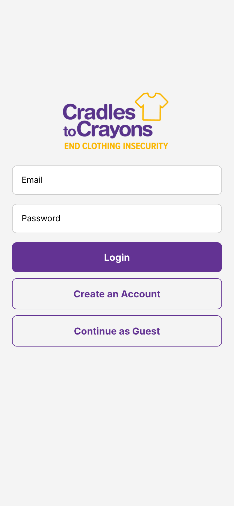
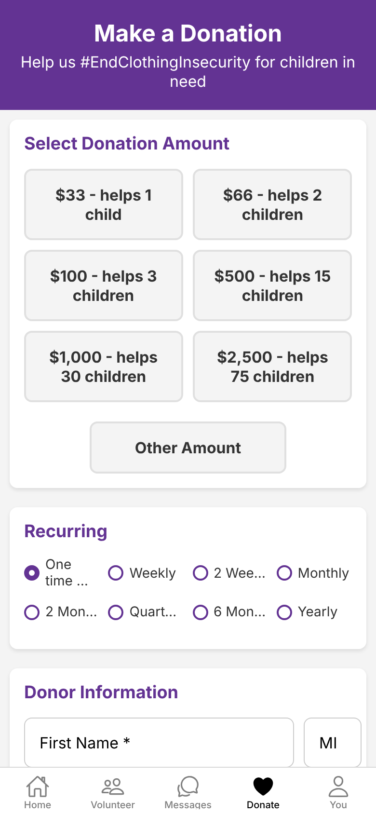

# Cradles to Crayons App

A mobile app I built as a freelance project for [Cradles to Crayons](https://www.cradlestocrayons.org/), a nonprofit that provides clothing and essentials to kids in need. Volunteers and donors use it to find events, see what items are needed most, donate, and keep up with the organization. Staff get an in-app admin panel to post updates.

<p>
  
  
  
  
  
</p>

## Features

- **Accounts:** sign up and log in with Firebase Auth, or continue as a guest
- **Volunteering:** browse upcoming events on a calendar, view the details, open the location in Google Maps, and set reminders
- **Donations:** preset or custom amounts, one-time or recurring, paid by card through Stripe
- **Item needs:** a live list of the items the organization needs most right now
- **Messaging:** chats, alerts, and push notifications
- **Admin panel:** staff can add events, alerts, and item needs from inside the app

## Stack

| | |
|---|---|
| App | React Native (Expo), TypeScript, React Navigation |
| Backend | Node.js, Express |
| Data / auth | Firebase Auth, Cloud Firestore |
| Payments | Stripe |

Stripe payments need a secret key, which can't be stored on the phone. So the Express server creates each payment intent and records the donation in Firestore. The app only gets back a client secret to confirm the payment.

## Running it

You'll need your own Firebase project and Stripe test keys.

**Backend**
```bash
cd backend-server
npm install
# create .env with STRIPE_SECRET_KEY=sk_test_...
# add firebase-admin-config.json (a service account key from Firebase)
npm run dev          # http://localhost:4242
```

**App**
```bash
cd c2cAPP
npm install
npx expo start
```
Then open it in Expo Go or an iOS/Android simulator.

## Structure

```
c2cAPP/
  App.tsx              navigation (tabs: Home, Volunteer, Messages, Donate, You)
  FirebaseConfig.ts
  app/screens/         all app screens
  assets/
backend-server/
  index.ts             Express + Stripe + Firestore
```